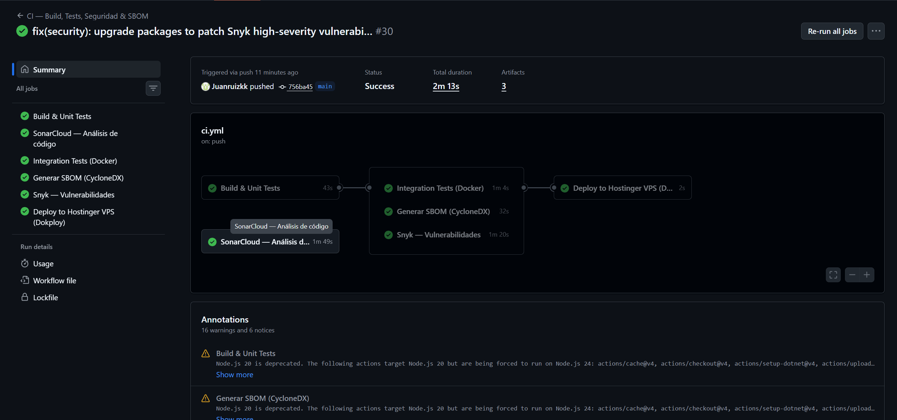
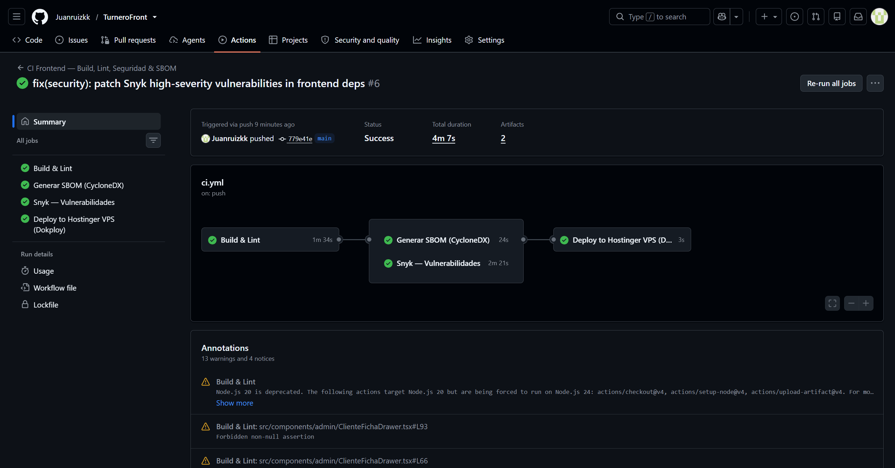
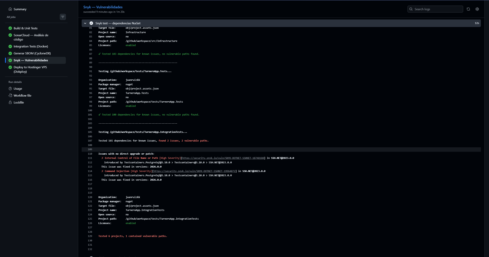
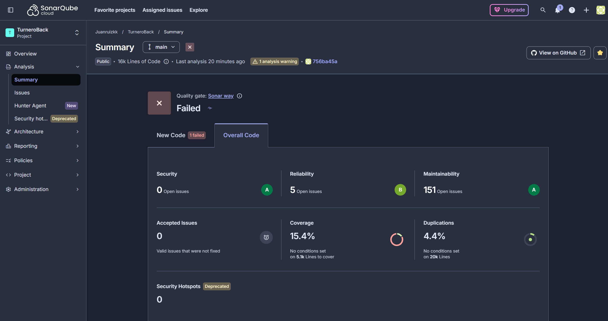
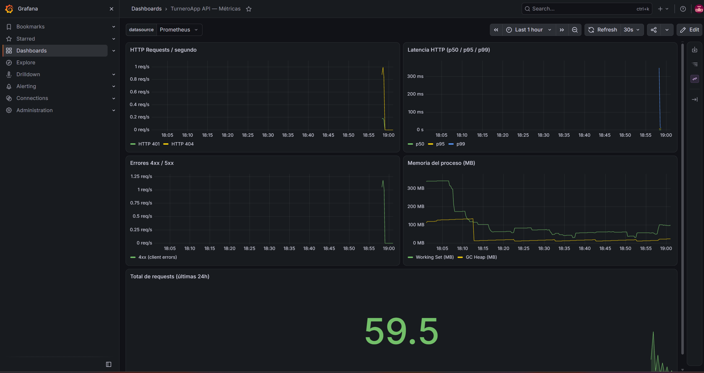
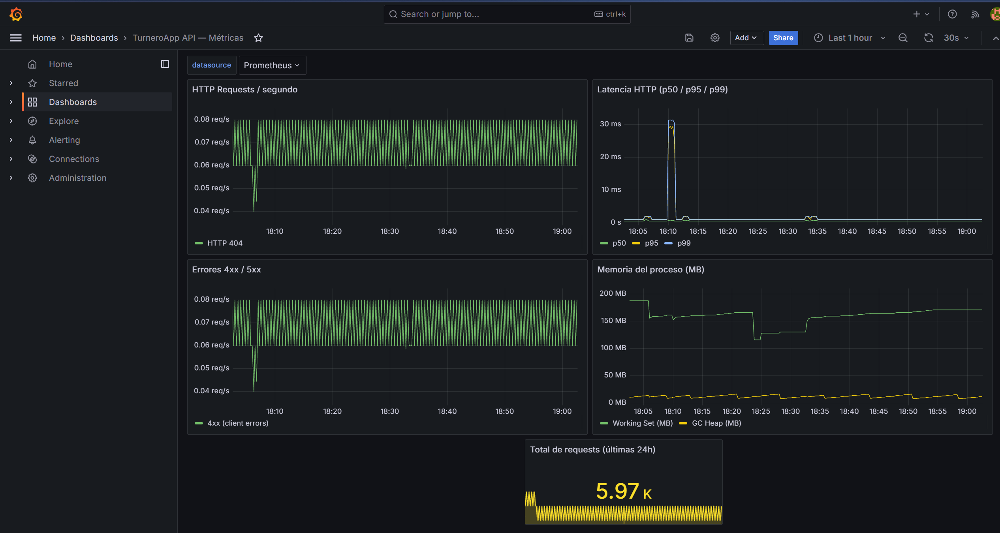
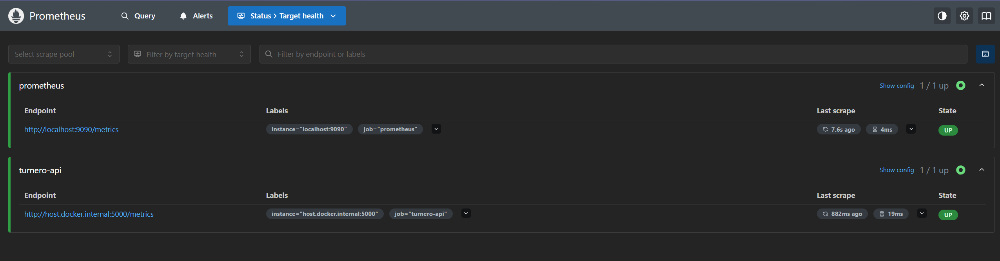
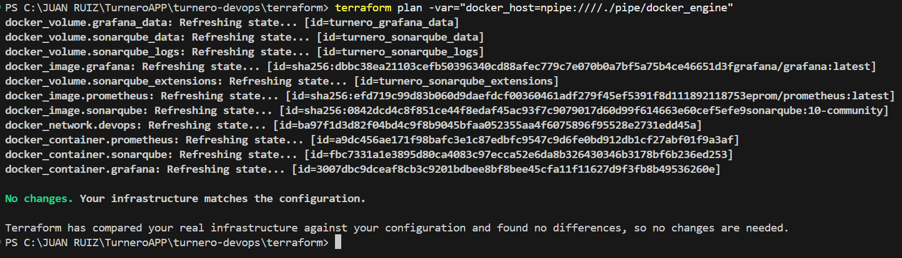

# turnero-devops

Infraestructura DevOps del proyecto **TurneroApp** — pipelines CI/CD, infraestructura como código, contenedores, análisis de seguridad y observabilidad, sobre una app .NET + React en producción.


> Proyecto open source. Parte de un ecosistema de 3 repos:
> [TurneroBack](https://github.com/Juanruizkk/TurneroBack) · [TurneroFront](https://github.com/Juanruizkk/TurneroFront) · **turnero-devops** (este)

## El ecosistema DevOps

| Herramienta | Rol en el pipeline |
|------|-------------|
| **GitHub Actions** | CI/CD: build, tests, análisis y deploy en cada push |
| **Terraform** | IaC: provisiona el stack de observabilidad y calidad |
| **Docker** | Contenedores multi-stage (build + runtime, usuario no-root) |
| **SonarCloud** | Análisis estático y Quality Gate |
| **Snyk + SBOM (CycloneDX)** | Seguridad de dependencias NuGet/npm/Docker |
| **Prometheus + Grafana** | Métricas y dashboards (local y producción) |

## Repositorios relacionados

| Repo | Descripción |
|------|-------------|
| [TurneroBack](https://github.com/Juanruizkk/TurneroBack) | API .NET 8 — CI con tests, SonarCloud, SBOM y Snyk |
| [TurneroFront](https://github.com/Juanruizkk/TurneroFront) | Frontend React — CI con ESLint, SBOM y Snyk |
| **turnero-devops** | Infraestructura IaC + observabilidad (este repo) |

---

## Stack

| Herramienta | Rol | Puerto local |
|-------------|-----|-------------|
| Terraform | IaC — provisiona los contenedores Docker | — |
| Prometheus | Scraping de métricas de la API | 9090 |
| Grafana | Dashboard de métricas | 3000 |
| SonarQube | Análisis estático de código (local) | 9000 |

---

## Estructura

```
turnero-devops/
├── .github/
│   └── workflows/
│       └── terraform.yml        # CI: validate + plan en cada push
├── terraform/
│   ├── main.tf                  # Provider Docker + red devops
│   ├── monitoring.tf            # Contenedores Prometheus y Grafana
│   ├── quality.tf               # Contenedor SonarQube
│   ├── outputs.tf               # URLs de cada servicio
│   └── variables.tf             # Puertos, passwords, rutas
├── monitoring/
│   ├── prometheus.yml           # Scrape config (API en /metrics)
│   └── grafana/
│       ├── datasources/
│       │   └── prometheus.yml   # Auto-provisioning del datasource
│       └── dashboards/
│           ├── provisioning.yml # Auto-provisioning de dashboards
│           └── turnero-api.json # Dashboard "TurneroApp API — Métricas"
├── docker-compose.devops.yml    # Alternativa rápida sin Terraform
├── docker-compose.prod.yml      # Self-host del stack completo (ver nota abajo)
└── .gitignore
```

> **Nota sobre el deploy de producción.** La infraestructura oficial corre en **Dokploy**, donde el backend y el frontend se despliegan como servicios tipo **Application** (build directo desde los repos `TurneroBack` / `TurneroFront`, trigger *On Push*), y las variables de entorno se cargan desde el panel de Dokploy. El stack de monitoreo sí corre como Compose (`docker-compose.monitoring.yml`).
>
> `docker-compose.prod.yml` **no lo usa esa infra**: es una referencia lista para **self-host** de todo el stack (Postgres + API + Frontend) con un solo comando, pensada para quien clone el proyecto y no use Dokploy:
>
> ```bash
> # Definí las variables en un .env junto al archivo y luego:
> docker compose -f docker-compose.prod.yml up -d
> ```

---

## Levantar el stack

### Opción A — Terraform (recomendado)

Requiere Docker Desktop corriendo.

```bash
cd terraform/

# Primera vez
terraform init

# Windows con Docker Desktop
terraform apply -var="docker_host=npipe:////./pipe/docker_engine"

# Linux / WSL2
terraform apply
```

Al finalizar, Terraform imprime las URLs:

```
grafana_url    = "http://localhost:3000"
prometheus_url = "http://localhost:9090"
sonarqube_url  = "http://localhost:9000"
```

Para destruir la infraestructura:

```bash
terraform destroy -var="docker_host=npipe:////./pipe/docker_engine"
```

### Opción B — Docker Compose

```bash
docker compose -f docker-compose.devops.yml up -d
```

---

## Credenciales por defecto

| Servicio | Usuario | Contraseña |
|----------|---------|------------|
| Grafana | `admin` | `turnero2024` |
| SonarQube | `admin` | `admin` (te pide cambiarla al primer login) |

---

## Dashboard de métricas

El dashboard **"TurneroApp API — Métricas"** se provisiona automáticamente al levantar Grafana. Incluye:

- HTTP Requests / segundo
- Latencia HTTP (p50 / p95 / p99)
- Errores 4xx y 5xx
- Memoria del proceso (MB)
- GC Collections por tipo
- Total de requests (últimas 24h)
- Tasa de errores

La API expone `/metrics` con `prometheus-net.AspNetCore`. Prometheus la scrapea cada 10 segundos.

---

## Pipeline CI

El workflow `.github/workflows/terraform.yml` corre en cada push a `main` que modifique archivos de `terraform/` o `monitoring/`:

1. `terraform fmt -check` — verifica formato
2. `terraform init` — descarga providers
3. `terraform validate` — valida sintaxis
4. `terraform plan` — planifica contra el Docker daemon del runner

No hace `apply` en CI — la infraestructura es local.

---

## Variables de Terraform

| Variable | Default | Descripción |
|----------|---------|-------------|
| `docker_host` | `unix:///var/run/docker.sock` | Socket Docker (Windows: `npipe:////./pipe/docker_engine`) |
| `grafana_port` | `3000` | Puerto Grafana |
| `prometheus_port` | `9090` | Puerto Prometheus |
| `sonarqube_port` | `9000` | Puerto SonarQube |
| `grafana_admin_password` | `turnero2024` | Contraseña Grafana |
| `monitoring_config_path` | `../monitoring` | Ruta a la carpeta monitoring/ |

---

## Capturas

**CI/CD en GitHub Actions**

| Pipeline backend (6 jobs) | Pipeline frontend (4 jobs) |
|---|---|
|  |  |

**Seguridad y calidad**

| Snyk backend | SonarCloud backend |
|---|---|
|  |  |

**Observabilidad**

| Grafana local (Terraform) | Grafana producción |
|---|---|
|  |  |

| Prometheus — targets activos | `terraform plan` — sin cambios |
|---|---|
|  |  |

## Licencia

MIT.
